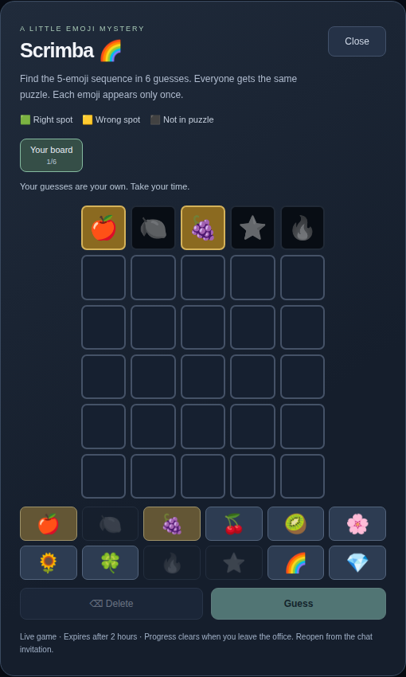

# Bespingle

A shared pixel office with a full-window, night-themed game area and direct
browser-to-browser audio and video. Walk onto a carpet to join a conversation;
walk off to leave it. Built with React, TypeScript, Go, and WebRTC.

Bespingle is an early proof of concept, published under the [MIT license](LICENSE).
The office is open to anyone with its link. There are no accounts, passwords,
attendance limits, or server-side profile accounts. Names and avatar preferences
are remembered in a browser cookie for one year. A server restart clears the office and
disconnects its participants.

## Run locally

Requires Node.js 22.12+ and Go 1.26+.

```sh
npm ci
npm run dev
```

Open [http://localhost:5555](http://localhost:5555) in two browser windows. Each
window joins as a separate person. The React development server runs on port
5555; Go runs on `127.0.0.1:6666`. Vite proxies `/ws` and `/api` so the browser
uses only port 5555. Vite also proxies `/mcp` for agent avatar uploads. Ctrl+C stops both services.

To start them separately, run `npm run dev:backend` and
`npm run dev:frontend` in separate terminals.

## Explore the office

- Choose a display name and one of six pixel avatars. Click your profile to
  change your name or avatar later. Your choices are remembered in a cookie.
- **Double-click a tile** to summon an orange portal at your feet and a blue portal at the destination. Fall through and pop up at the other end; targeting a stationary player swaps both avatars simultaneously. Walls block portal placement, but portals can cross them.
- Move with **WASD or the arrow keys**. Hold a key to keep walking at a steady pace without
  pausing between tiles; each 48-pixel tile takes 240 ms. Releasing the key finishes the
  current tile and stops there.
  Hold **Shift** while moving to sprint up to **3 tiles per tick** (240 ms),
  stopping before walls or occupied tiles. Releasing Shift returns to walking.
  The hidden grid reserves both the source and destination during a step, so
  players cannot share tiles or swap through one another. A blocked move into
  another player makes the moving avatar bounce back. Walls block movement;
  furniture does not.
- Press **Z** to toggle dancing for everyone to see. Walking stops the dance.
- **Scroll over the game area** to zoom. The camera follows your avatar.
- Share a carpet to talk. The Nook, The Studio, and The Commons have 2, 4, and 8
  visual chairs, with no attendance caps. Walking onto a chair tile seats your
  avatar visually; the carpet determines conversation membership.
- On your first carpet entry, choose **both**, **microphone only**, **video only**,
  or **neither**. Neither still receives other participants' media.
- Enabled devices stay on across carpets and the open floor until you switch
  them off with the HUD controls or leave the game. The choice is remembered
  for that game session; entering another carpet does not prompt again.
- Click the video strip or **Expand** to cover the game area with videos.
  Movement pauses while videos are expanded.
- Each carpet has a temporary text chat. Messages go only to participants
  connected to that carpet when sent, including the sender. Later arrivals get
  no earlier messages. The server relays messages without saving or logging
  their content; each browser keeps at most 100 messages in memory, cleared
  when leaving the carpet, disconnecting, or reloading. Chat is not written to
  browser storage. Recipients can still copy messages they receive.
- Type **/scrimba** in carpet chat to start an emoji guessing game. Your board
  opens immediately and others on the carpet get a **Launch Scrimba** invitation.
  Find the shared five-emoji sequence in six guesses. Solutions and guesses use
  unique emojis. Green means the correct position; yellow means it belongs
  elsewhere. Dark tiles mark emojis absent from the puzzle and disable those
  keys for later guesses. Each player solves independently. Click a
  player's name to inspect their board: only colors are shared until you finish
  your own puzzle, then the emojis and solution are revealed. Close and reopen
  from the invitation to continue. Joined games also have a **Resume Scrimba**
  button on their carpet, including after you walk away and return. Scrimba uses WebSocket events and transient
  server/browser memory, with no database or browser storage. Games expire after
  two hours or a server restart; leaving the office loses your player identity.
  Disconnected players are removed, games support up to 64 connected players,
  and each creator can have three unfinished boards. Completed games can be
  retired early when the server needs space for a new game.
- Click **Share screen** on a carpet to choose a tab, window, or display. Everyone
  on that carpet can watch alongside your camera; use **Expand** for a larger view.
  Stop with **Stop sharing** or the browser’s sharing control. Leaving the carpet
  or office also stops sharing, including a pending screen selection. Multiple
  people can share at once. Screen sharing sends video only, without system audio.
- **Leave office** stops local devices. A new game starts with devices off.

## Custom avatars with Claude or Codex

The avatar selector keeps the six defaults and offers **Create your own with
Claude or Codex** in both the join form and profile editor. Uploads never become
a shared gallery: only the originating browser gets a custom selector option.
The worn avatar is visible to office participants and its unlisted asset URL is
readable by anyone who knows it. This is not private file storage.

1. Connect your agent to the office's **Streamable HTTP** MCP endpoint:
   `https://YOUR-OFFICE-DOMAIN/mcp` (locally, `http://localhost:5555/mcp`).
   For Codex CLI, run `codex mcp add bespingle --url https://YOUR-OFFICE-DOMAIN/mcp`.
   For Claude Code, run
   `claude mcp add --transport http bespingle https://YOUR-OFFICE-DOMAIN/mcp`.
   Hosted agents need a publicly reachable HTTPS address; localhost only works
   for agents running on your own computer.
2. In the selector, generate an upload code and copy its agent prompt. Describe
   the character you want. The code grants one successful upload for 30 minutes;
   share it only with your agent. Keep the selector open during upload.
3. The agent calls `avatar_spec` to read the format, creates the PNG, then calls
   `upload_avatar` with `uploadCode`, `pngBase64` (standard base64 file bytes,
   without a data URL prefix) and, optionally, `walkFrames` and `danceFrames`
   (each 2 to 16, default 2). These tools provide the format and storage;
   the agent supplies image generation or drawing capabilities.
4. After storage succeeds, the browser selects the uploaded avatar. Click
   **Enter the office** or **Save profile** to use and remember it.

The sprite sheet is a transparent PNG of 64 × 64 cells, at most **1 MiB**,
**256 px** tall (four rows: down, left, right, up) and **64 × (2 + W + D) px**
wide, where W is the number of walk frames and D the number of dance frames,
each a whole number from 2 to 16 (default 2). Columns run idle, walk 1 … walk W,
seated, dance 1 … dance D, so sheets range from 384 to 2176 px wide; the
classic two-and-two sheet is 384 × 256. Walking plays the walk frames in order
on a loop at 120 ms per frame, and dancing plays the dance frames in order on a
loop at 160 ms per frame. Feet align at (32, 58) within each cell, and every
cell belongs to the same character. The avatar's reference is the content hash
of the stored PNG, followed by `-W-D` unless both counts are 2. Invalid images
are rejected before storage; accepted PNGs are decoded and re-encoded to remove
metadata. Missing images fall back to the chosen default avatar.

The cookie stores only a name, default selection, and custom avatar references;
image bytes live in the bucket. It is scoped to this site, uses `SameSite=Lax`
and `Secure` on HTTPS, and expires after one year. Clearing cookies removes
this browser's saved selection; it does not delete uploaded bucket objects.
Browser tabs share preferences on their next reload. Pending upload codes live
in server memory and are invalidated by a deployment/restart. Uploaded avatars
survive restarts. There is no bucket listing or avatar deletion API.

Connection syntax follows the official
[Codex MCP instructions](https://developers.openai.com/learn/docs-mcp) and
[Claude Code MCP instructions](https://code.claude.com/docs/en/mcp).

## Scrimba



## Direct audio and video

The Go server handles names, positions, carpet membership, device flags, temporary carpet chat, and
WebRTC connection setup over WebSocket. It does not receive or forward audio or
video. Browsers send media directly to other participants on the same carpet.
Leaving a carpet closes those peer connections. Local devices may remain on,
but no media is sent to other participants while you are on the open floor.

Connection discovery uses `stun:stun.cloudflare.com:3478`.
[Cloudflare documents its public STUN service as free and unlimited](https://developers.cloudflare.com/realtime/turn/faq/).
There is no TURN relay fallback, so calls may fail on networks that prevent a
direct WebRTC connection. Remote microphone and camera access requires HTTPS;
localhost is suitable for development.

Capture targets 1280×720 at 30 fps; actual quality depends on the device,
browser, and connection. Each browser sends one copy to every other participant
in its call. Eight people sharing a carpet create 28 peer connections, with up
to seven outgoing streams per person. Hosting avoids media relay bandwidth, but
participants still need enough upload capacity for those copies.

Microphone and camera controls work independently. Disabling one stops only
its own track. Leaving the game stops all capture, including late permission
results. Use headphones when testing multiple windows in the same physical room.

### Microphone noise suppression

Noise suppression, echo cancellation, and automatic gain control are requested
by default for every microphone. Open **Audio** beside the mic control to toggle
noise suppression, including while speaking. Changes reuse the same microphone
track and apply to everyone in your conversation. Some browsers require turning
the mic off and on to apply a change; the panel will tell you when this is needed.
Your choice lasts until the
page is reloaded, including when you mute and re-enable the microphone.

The panel reports whether the browser has enabled suppression and identifies
unsupported browsers. Processing uses the browser's built-in audio engine on
your device; effectiveness depends on the browser and microphone. It reduces
background noise but cannot guarantee removal of every sound.

### Camera backgrounds

Use **Background** beside the camera control to choose **Blur**, **Sky**,
**Forest**, or a custom JPG, PNG, or WebP image (up to 10 MB). You can also choose
an effect in the device prompt before enabling your camera. **None** restores
the original camera feed. Your choice lasts for the current page session.

Effects use Google's open source [MediaPipe Image Segmenter](https://github.com/google-ai-edge/mediapipe)
(`@mediapipe/tasks-vision` 0.10.32) and the Selfie Segmenter landscape model
(float16, version 1), licensed under Apache 2.0. The runtime and model are served
with the application; camera frames and custom images stay on the device until
the processed video is sent directly to conversation peers. No inference service
or CDN is required. See [third-party notices](public/models/NOTICE.txt) and the
[bundled license](public/models/MEDIAPIPE-LICENSE.txt).

Segmentation and compositing run in a dedicated worker, capped at 960 pixels
wide and 20 fps, with one frame in flight. Slower devices may deliver fewer
frames. Effects require WebAssembly, OffscreenCanvas, and canvas capture;
unsupported browsers can continue using **None**. If an active effect fails,
the camera stops instead of publishing the original background. Model-loading
failures preserve the previous effect.

## Production container

The multi-stage Docker build compiles the frontend and Go server into one
container. Go serves the built app, `/api`, and `/ws` on the same port. There is
no Vite server in production.

```sh
docker build -t bespingle .
docker run --rm -p 8080:8080 -e ALLOWED_ORIGINS=http://localhost:8080 bespingle
```

Open [http://localhost:8080](http://localhost:8080). The container uses
`HOST=0.0.0.0`, `PORT=8080`, and `STATIC_DIR=/app/dist` by default. Go reads process
environment variables; it does not automatically load `.env` files. See
[.env.example](.env.example) for the available settings.

## Deploy on Railway

Connect a Railway service to [DanbisDev/bespingle](https://github.com/DanbisDev/bespingle)
and select **master** as its deployment branch. Keep the repository root as the
build directory and use its `Dockerfile`. Set the healthcheck path to
`/api/health` with a 120-second timeout, and run **one replica**. Generate a public
HTTPS domain for the service.

The server listens on Railway's injected `PORT`. It allows WebSocket connections
from the exact HTTPS origin derived from `RAILWAY_PUBLIC_DOMAIN`. For an
additional domain, set `ALLOWED_ORIGINS` to comma-separated full origins such as
`https://office.example.com`; include every origin you intend to allow.

Pushes to the connected **master** branch trigger native GitHub autodeploys.
Railway provides the public HTTPS domain. See the official
[GitHub autodeploy documentation](https://docs.railway.com/deployments/github-autodeploys)
and [healthcheck documentation](https://docs.railway.com/deployments/healthchecks).

All participants and movement reservations live in the Go process. Deployments
restart that process and disconnect existing sessions. Multiple replicas would
create separate offices because state is not shared. This version needs no
database or persistent volume for the office. Custom avatars require an optional
Railway bucket:

1. Add a **Bucket** to the Railway project.
2. In the app service, configure `AVATAR_BUCKET_ENDPOINT`, `AVATAR_BUCKET_NAME`,
   `AVATAR_BUCKET_ACCESS_KEY_ID`, `AVATAR_BUCKET_SECRET_ACCESS_KEY`, and
   `AVATAR_BUCKET_REGION` using references to the bucket's `ENDPOINT`, `BUCKET`,
   `ACCESS_KEY_ID`, `SECRET_ACCESS_KEY`, and `REGION` variables. See `.env.example`.
3. Redeploy the service. Test an upload through the selector.

[Railway buckets](https://docs.railway.com/storage-buckets) are private and
S3-compatible. The server signs uploads and proxies PNG reads; credentials stay
on the server, and bucket CORS/public access is unnecessary. New buckets use
virtual-hosted addressing. Set `AVATAR_BUCKET_FORCE_PATH_STYLE=true` only when
an older bucket's Credentials tab requires it. Without bucket configuration,
MCP format instructions and default avatars work; upload-code creation reports
that storage is unavailable. Partial/invalid configuration fails startup.

## Checks

```sh
npm run build
npm run test:backend
# After the build, with Chromium installed (or CHROME_PATH set):
npm run test:avatars
```

With the local development stack running in another terminal:

```sh
npx playwright install chromium
npm run test:grid
npm run test:browser
npm run test:chat
npm run test:scrimba
npm run test:backgrounds
npm run test:audio
```

Alternatively, use an existing Chrome installation:

```sh
CHROME_PATH=/absolute/path/to/google-chrome npm run test:grid
CHROME_PATH=/absolute/path/to/google-chrome npm run test:browser
CHROME_PATH=/absolute/path/to/google-chrome npm run test:chat
CHROME_PATH=/absolute/path/to/google-chrome npm run test:scrimba
CHROME_PATH=/absolute/path/to/google-chrome npm run test:backgrounds
CHROME_PATH=/absolute/path/to/google-chrome npm run test:audio
```

The browser checks use synthetic microphones and cameras. They cover grid
movement and collisions, carpet membership, game-area sizing, zoom, media
connections, device reuse, device shutdown, and temporary carpet chat delivery
and clearing. The backgrounds check runs real segmentation, tests custom image
compositing and live effect switching, and checks failure handling and capture
cleanup. Screenshots go to the ignored
`test-results/browser/` directory. The avatars check starts an isolated HTTP server with test storage, uploads through
real MCP requests, and checks browser cookies, sprite rendering, profile edits,
reload persistence, and selector isolation. It needs no Railway credentials.
Backend checks include S3 request signing, MCP SDK interoperability, upload validation, and race detection,
movement reservations, signaling isolation, and invalid messages and origins.

## Project layout

| Path | Purpose |
| --- | --- |
| `src/App.tsx` | Join/profile UI, media prompt, video strip, and HUD |
| `src/GameCanvas.tsx` | Game rendering, follow camera, zoom, and tile movement |
| `src/art.ts`, `src/avatarArt.ts` | Code-drawn pixel office and default/custom avatar rendering |
| `src/AvatarPicker.tsx`, `src/profile.ts` | Agent upload instructions, pairing, and profile cookies |
| `server/avatars.go` | HTTP MCP tools, upload codes, validation, and Railway S3 storage |
| `src/useGame.ts` | WebSocket state and signaling delivery |
| `src/usePeerMedia.ts` | Peer connections and device lifecycle |
| `src/cameraBackground.ts`, `src/cameraBackground.worker.ts` | Local camera segmentation and background compositing |
| `src/world.ts` | Shared map types, tile helpers, and wall collision |
| `server/world.json` | Map geometry, carpets, chairs, and furniture |
| `server/` | In-memory office, authoritative movement, signaling, and HTTP serving |

The Go binary embeds the map at build time. Restart Go after editing
`server/world.json`; Vite reloads the frontend automatically.

Contributions are welcome; see [CONTRIBUTING.md](CONTRIBUTING.md).
Bespingle's source and code-drawn artwork are MIT licensed. Dependencies retain
their respective licenses.
